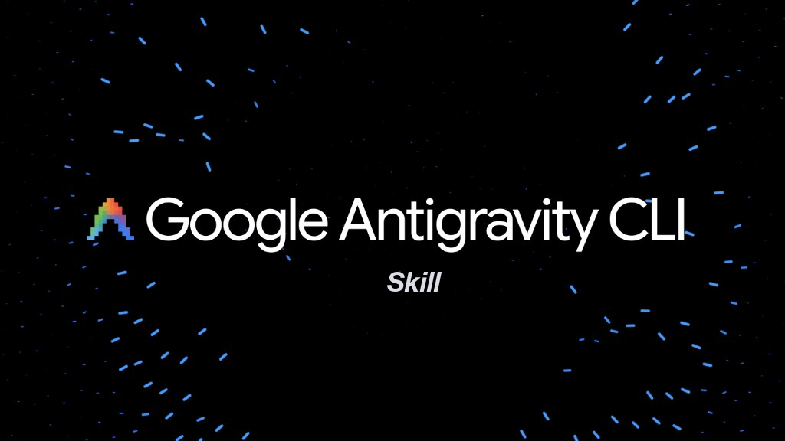

<p align="center">
  
</p>

# Antigravity CLI (agy) Skill

[](https://github.com/jacob-bd/universal-skills-manager)
[](https://github.com/jacob-bd/antigravity-cli-skill/stargazers)
[](https://makeapullrequest.com)

> ☕ **If you find this skill useful, consider [buying me a coffee](https://buymeacoffee.com/jacobbd).**
> It's free and built in my spare time. A coffee helps me cover my time and keep shipping updates. Thank you! 🙏
>
> <a href="https://buymeacoffee.com/jacobbd"></a>

An AI agent skill for working with Google's Antigravity CLI (`agy`) -- the official successor to Gemini CLI.

## What This Is

This skill is built primarily for AI coding agents (**Claude Code, Codex CLI, Codex App, OpenCode, Cursor, Gemini CLI**) to invoke, delegate to, and automate Google's `agy` CLI natively. It covers:

- **Complete `agy` v1.5.12 reference**: Flags, subcommands, settings, sandbox rules, environment variables, and interactive TUI workflows
- **Agent-native headless delegation without `--dangerously-skip-permissions`**:
  - Ephemeral session overrides via `--settings '<json>'` for read-only plan reviews, read-only Git diff reviews, and scoped write+test runs (avoiding host-agent approval prompts in Claude Code, Codex, and OpenCode)
  - Zero-turn quota, model, and config checks (`agy -p "/usage" --output-format json`, `agy models`, `GEMINI_API_KEY` handling) with unambiguous quota reading rules and model/effort routing
  - Strict completion, denial, and timeout verification (`finished_reason`, `denied_actions[]`, `--conversation` resume, `stream-json` parsing, and isolated `git worktree` coding)
- **Multi-agent orchestration & extensibility**:
  - Parallel Python fan-out workflows (`run_workflow`), interactive Swarms (`/swarm` and `/swarm board`), and cloud Remote Agents (`--remote-agent`)
  - Agent Client Protocol stdio server (`agy acp`), MCP server management (`agy mcp`), plugins & validation (`agy plugin`), lifecycle hooks, and custom Markdown agents
- **Migration & automation**:
  - Gemini CLI to `agy` migration guide and flag mapping
  - Production-ready recipes for CI/CD, structured `--json-schema` output, and multi-agent pipelines

## Background

Google announced at I/O 2026 (May 19) that Gemini CLI is transitioning to Antigravity CLI. Consumer/free users lose Gemini CLI access on June 18, 2026. The `agy` CLI is a Go binary that shares the same agent harness as the Antigravity IDE desktop application.

## Installation

### Quick Install (`npx skills` — Recommended)

Install into Claude Code, Codex, OpenCode, Cursor, Gemini CLI, and other Agent Skills-compatible tools in one command:

```bash
# Interactive (pick target agents and global vs. project scope)
npx skills add jacob-bd/antigravity-cli-skill
```

Non-interactive and maintenance commands:

```bash
# Global install for the main coding agents (no prompts)
npx skills add jacob-bd/antigravity-cli-skill -g -a claude-code -a codex -a opencode -a cursor -a gemini-cli -y

# Global install to all detected agents (add --copy if your environment does not support symlinks)
npx skills add jacob-bd/antigravity-cli-skill -g --all

# Preview skills in this repository without installing
npx skills add jacob-bd/antigravity-cli-skill --list

# Check for updates and upgrade installed skills
npx skills check
npx skills update
```

> **Note on flags & Antigravity paths:** `--all` is shorthand for `--skill '*' --agent '*' -y`. Passing `-a antigravity` installs globally to `~/.gemini/antigravity/skills/` (Antigravity IDE) and project-locally to `.agents/skills/` (shared with `agy` CLI and Codex). To install globally into Antigravity CLI's `~/.gemini/config/skills/` directory, use USM or the manual `rsync` command below.

### Universal Skills Manager (USM)

[Universal Skills Manager](https://github.com/jacob-bd/universal-skills-manager) auto-discovers `skills/antigravity-cli/`, deploys the skill to every detected tool (including Antigravity CLI's `~/.gemini/config/skills/`), and keeps copies in sync.

### Manual Install (`git clone` + `rsync`)

Install the **entire `skills/antigravity-cli/` folder**, not just `SKILL.md`. The main file links to `resources/*.md` and `examples/usage_patterns.md`, so copying only `SKILL.md` breaks those references.

| Tool | User-scope skill directory |
| :--- | :--- |
| Claude Code | `~/.claude/skills/antigravity-cli/` |
| Codex / Gemini CLI | `~/.agents/skills/antigravity-cli/` |
| Antigravity CLI | `~/.gemini/config/skills/antigravity-cli/` |
| Antigravity (IDE) | `~/.gemini/antigravity/skills/antigravity-cli/` |
| OpenCode | `~/.config/opencode/skills/antigravity-cli/` |
| Cursor | `~/.cursor/skills/antigravity-cli/` |
| Cline | `~/.cline/skills/antigravity-cli/` |
| Alef Agent | `~/.alef-agent/workspace/skills/antigravity-cli/` |

```bash
# Clone once, then sync only the clean skill folder (example: Claude Code)
git clone https://github.com/jacob-bd/antigravity-cli-skill.git
TOOL_DIR=~/.claude/skills/antigravity-cli
mkdir -p "$TOOL_DIR"
rsync -a --delete --exclude '.DS_Store' antigravity-cli-skill/skills/antigravity-cli/ "$TOOL_DIR/"
```

The same pattern works for project scope (e.g. `.agents/skills/antigravity-cli/` inside a repository) and for `agy`'s alternate global skills root (`~/.gemini/antigravity-cli/skills/`).

## Files

The installable skill lives under `skills/antigravity-cli/` so repo-only files (`README.md`, `CHANGELOG.md`, `assets/`) stay out of installed agent skill directories.

| File | Description |
| :--- | :--- |
| [`skills/antigravity-cli/SKILL.md`](skills/antigravity-cli/SKILL.md) | Main skill definition -- agent-first delegation contract and core `agy` v1.5.12 reference |
| [`skills/antigravity-cli/resources/delegation_playbook.md`](skills/antigravity-cli/resources/delegation_playbook.md) | Playbook for AI assistants (Claude Code, Codex, OpenCode) delegating reviews, research, and coding tasks natively |
| [`skills/antigravity-cli/resources/cheat_sheet.md`](skills/antigravity-cli/resources/cheat_sheet.md) | Quick reference for flags, subcommands, settings, env vars, and Gemini CLI migration mapping |
| [`skills/antigravity-cli/resources/agents_and_customization.md`](skills/antigravity-cli/resources/agents_and_customization.md) | Custom agent schema, `run_workflow`, swarms, plugins, hooks, and skill metadata |
| [`skills/antigravity-cli/resources/tui_reference.md`](skills/antigravity-cli/resources/tui_reference.md) | Interactive TUI keybindings, `/swarm board`, `/projects`, `/diff`, `/btw`, and settings |
| [`skills/antigravity-cli/examples/usage_patterns.md`](skills/antigravity-cli/examples/usage_patterns.md) | Production-ready, runnable automation recipes and workflows |

## Status

This skill tracks locally installed `agy` **v1.5.12**. See [`CHANGELOG.md`](CHANGELOG.md) for full `agy` release history.

## Support

If this skill saves you time or money, you can help support its development. Any support is hugely appreciated. 🙏

<a href="https://buymeacoffee.com/jacobbd"></a>
