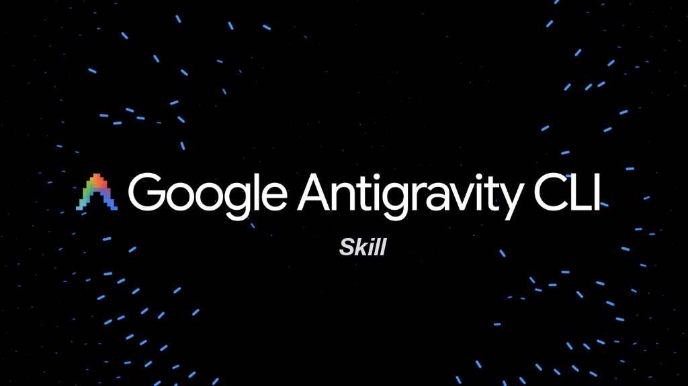

<p align="center">
  
</p>

# Antigravity CLI (agy) Skill

[](https://github.com/jacob-bd/universal-skills-manager)
[](https://github.com/jacob-bd/antigravity-cli-skill/stargazers)
[](https://makeapullrequest.com)

> ☕ **If you find this skill useful, consider [buying me a coffee](https://buymeacoffee.com/jacobbd).**
> It's free and built in my spare time. A coffee helps me cover my time and keep shipping updates. Thank you! 🙏
>
> <a href="https://buymeacoffee.com/jacobbd"></a>

An AI agent skill for working with Google's Antigravity CLI (`agy`) -- the official successor to Gemini CLI.

## What This Is

This is a skill built primarily for AI coding agents (**Codex CLI, Codex App, Claude Code, OpenCode, Cursor, Gemini CLI**) to invoke and automate the `agy` command-line tool natively. It covers:

- Complete flag, subcommand, and environment reference for `agy` **v1.5.7**
- **Agent-native delegation without `--dangerously-skip-permissions`**:
  - Ephemeral session overrides via `--settings '<json>'` for read-only plan reviews, read-only Git diff reviews, and scoped write+test runs (preventing host-agent approval interruptions in Codex and Claude Code)
  - Zero-turn pre-flight quota checks via `agy -p "/usage" --output-format json` with low-quota warnings and quota-pool fallback guidance
  - Strict completion and denial verification (`finished_reason`, `denied_actions[]`, and exit code `3` timeout/API errors)
- New `agy` v1.5.0–v1.5.7 capabilities:
  - Agent Client Protocol stdio server (`agy acp`) with `--login`, `--process-per-session`, and `auto` mode
  - Cloud Remote Agent sessions (`--remote-agent`) and local project management (`/projects`)
  - Parallel multi-agent Swarms (`/swarm` and `/swarm board` live view)
  - Enriched lifecycle hooks (`hookEventName`, `cwd`, `toolCall.id`, `continuation_active` on `Stop` hooks, `PreInvocation` termination, `PLUGIN_ROOT`/`PLUGIN_DATA`)
  - Updated Auto mode defaults (`v1.5.7`), `AGY_ADC_AUTH` PAYG Auto mode + Gemini 4 Carbon/Hydrogen/Argon, `ANTIGRAVITY_DISABLE_EMBEDDED_RIPGREP`, and Claude Code plugin/command/hook conversion
- Gemini CLI to `agy` migration guide and flag mapping
- Best practices for automation, CI/CD, and multi-agent workflows

## Background

Google announced at I/O 2026 (May 19) that Gemini CLI is transitioning to Antigravity CLI. Consumer/free users lose Gemini CLI access on June 18, 2026. The `agy` CLI is a Go binary that shares the same agent harness as the Antigravity IDE desktop application.

## Files

| File | Description |
| :--- | :--- |
| `SKILL.md` | Main skill definition -- agent-first contract and complete v1.5.7 reference |
| `resources/cheat_sheet.md` | Quick reference card with native agent recipes, flags, subcommands, env vars, and migration mapping |
| `resources/delegation_playbook.md` | Playbook for AI assistants (Codex, Claude Code, OpenCode) delegating reviews and coding tasks natively |
| `resources/agents_and_customization.md` | Custom agent schema, swarms, manifests, plugin authoring, hooks, skill metadata |
| `resources/tui_reference.md` | Interactive TUI keybindings, `/swarm board`, `/projects`, `/diff`, `/btw`, settings |
| `examples/usage_patterns.md` | 33 production-ready, runnable automation recipes and workflows |

## Installation

Install the **entire skill folder**, not just `SKILL.md`. The main file links to `resources/*.md` and `examples/usage_patterns.md`, so a folder that contains only `SKILL.md` has broken references.

| Tool | User-scope skill directory |
| :--- | :--- |
| Claude Code | `~/.claude/skills/antigravity-cli/` |
| Codex / Gemini CLI | `~/.agents/skills/antigravity-cli/` |
| Antigravity CLI | `~/.gemini/config/skills/antigravity-cli/` |
| Antigravity (IDE) | `~/.gemini/antigravity/skills/antigravity-cli/` |
| OpenCode | `~/.config/opencode/skills/antigravity-cli/` |
| Cursor | `~/.cursor/skills/antigravity-cli/` |
| Cline | `~/.cline/skills/antigravity-cli/` |
| Alef Agent | `~/.alef-agent/workspace/skills/antigravity-cli/` |

```bash
# Clone once, then install into any tool's skill directory (example: Claude Code)
git clone https://github.com/jacob-bd/antigravity-cli-skill.git
TOOL_DIR=~/.claude/skills/antigravity-cli
mkdir -p "$TOOL_DIR"
rsync -a --delete --exclude '.git' --exclude '.DS_Store' antigravity-cli-skill/ "$TOOL_DIR/"
```

The same pattern works for project scope (e.g. `.agents/skills/antigravity-cli/` inside a repository) and for agy's alternate global skills root, `~/.gemini/antigravity-cli/skills/`.

Prefer automation? [Universal Skills Manager](https://github.com/jacob-bd/universal-skills-manager) deploys the folder to every detected tool and keeps the copies in sync.

## Status

This skill tracks locally installed `agy` v1.5.7.

## Support

If this skill saves you time or money, you can help support its development. Any support is hugely appreciated. 🙏

<a href="https://buymeacoffee.com/jacobbd"></a>
